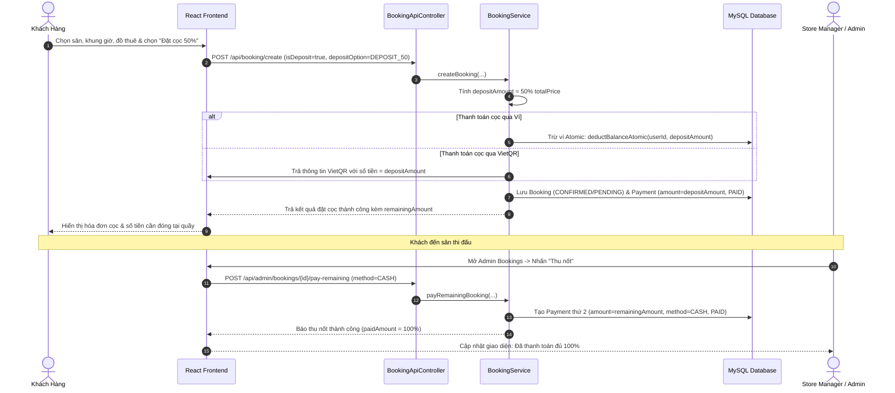
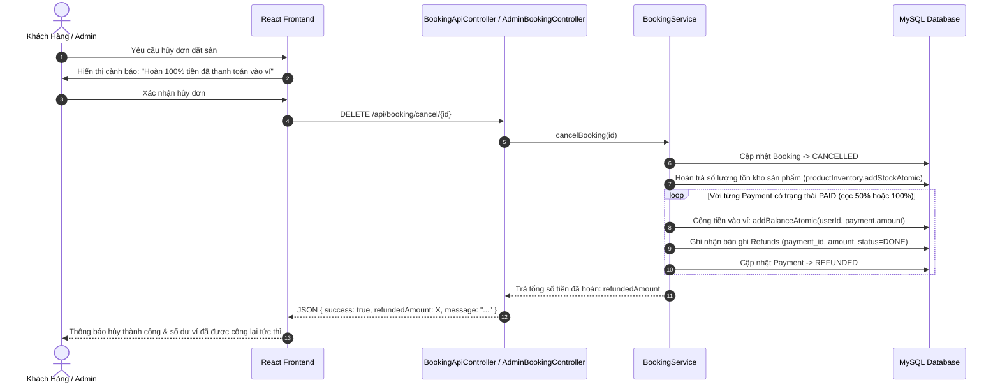
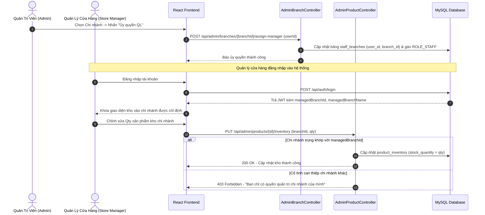

# 🏸 Ways Station Badminton - Hệ Thống Đặt Sân & Quản Lý Chuỗi Cầu Lông Trực Tuyến

<p align="center">
  
  
  
  
  
  
</p>

> **Đồ Án Môn Học - Nhóm 19**  
> Dự án phần mềm quản lý chuỗi 4 cụm cơ sở sân cầu lông tiêu chuẩn quốc tế BWF tại TP.HCM (`Ways Station NVL`, `Ways Station DQII`, `Ways Station NQA`, `Ways Station HB`).  
> Hệ thống hỗ trợ đa nền tảng: Cổng đặt sân & thanh toán linh hoạt cho khách hàng, Cổng quản trị phân cấp cho **Quản trị viên toàn hệ thống (Admin)** và **Quản lý cửa hàng từng chi nhánh (Store Manager)**.

---

## 📑 Mục Lục
1. [Giới Thiệu Chung & Nghiệp Vụ Cốt Lõi](#1-giới-thiệu-chung--nghiệp-vụ-cốt-lõi)
2. [Các Tính Năng Mới Bổ Sung](#2-các-tính-năng-mới-bổ-sung)
   - [Thanh toán đặt cọc 50% & Thu nốt tại quầy](#21-thanh-toán-đặt-cọc-50--thu-nốt-tại-quầy)
   - [Luồng hoàn tiền 100% về ví khi hủy đơn](#22-luồng-hoàn-tiền-100-về-ví-khi-hủy-đơn)
   - [Ủy quyền Quản lý cửa hàng (Store Manager) & Quản lý tồn kho chi nhánh](#23-ủy-quyền-quản-lý-cửa-hàng-store-manager--quản-lý-tồn-kho-chi-nhánh)
3. [Sơ Đồ Luồng Nghiệp Vụ (Sequence Diagrams)](#3-sơ-đồ-luồng-nghiệp-vụ-sequence-diagrams)
4. [Kiến Trúc Kỹ Thuật & Công Nghệ](#4-kiến-trúc-kỹ-thuật--công-nghệ)
5. [Cấu Trúc Thư Mục Dự Án](#5-cấu-trúc-thư-mục-dự-án)
6. [Hướng Dẫn Cài Đặt & Triển Khai Chuẩn Quy Trình](#6-hướng-dẫn-cài-đặt--triển-khai-chuẩn-quy-trình)
7. [Ma Trận Phân Quyền (RBAC) & Tài Khoản Kiểm Thử](#7-ma-trận-phân-quyền-rbac--tài-khoản-kiểm-thử)
8. [Tài Liệu RESTful API Chi Tiết](#8-tài-liệu-restful-api-chi-tiết)
9. [Quy Chuẩn Phát Triển & Đóng Góp (Git Conventions)](#9-quy-chuẩn-phát-triển--đóng-góp-git-conventions)

---

## 1. Giới Thiệu Chung & Nghiệp Vụ Cốt Lõi

**Ways Station Badminton** giải quyết bài toán vận hành thực tế cho chuỗi sân cầu lông quy mô lớn:
- **Dành Cho Khách Hàng**:
  - Tra cứu trực quan sơ đồ sân và ma trận slot trống theo thời gian thực tại 4 cụm chi nhánh.
  - Đặt sân linh hoạt (đặt lẻ theo giờ, đặt cố định dài hạn theo tháng).
  - Thuê vợt thi đấu cao cấp (Yonex, Victor, Lining), giày thể thao, mua nước giải khát kèm theo đơn.
  - Tích hợp cổng thanh toán đa kênh: **Ví điện tử nội bộ**, **VietQR động**, **Chuyển khoản**, **Tiền mặt**.
  - Đăng ký và gia hạn các gói Hội viên VIP (Silver, Gold, Diamond, Student) với mức giảm giá tự động.
  - Tra cứu đơn đặt sân nhanh chóng qua mã đơn (`WAY-YYYYMMDD-xxxx`) hoặc số điện thoại.
  - Sàn giao dịch chuyển nhượng suất chơi (Slot Transfer) khi khách bận lịch đột xuất.
- **Dành Cho Quản Trị Viên & Cửa Hàng (Admin & Staff)**:
  - Bảng điều khiển (Admin Dashboard) thống kê doanh thu, tỷ lệ lấp đầy sân và lượng khách theo ngày/tuần/tháng.
  - Quản lý cơ sở sân, danh mục sản phẩm, bảng giá giờ cao điểm/thấp điểm.
  - Xác thực bảo mật hai lớp: Đổi mật khẩu & Quên mật khẩu qua **Google SMTP Email OTP 6 số**.

---

## 2. Các Tính Năng Mới Bổ Sung

### 2.1. Thanh toán đặt cọc 50% & Thu nốt tại quầy
* **Bối cảnh**: Nhiều khách hàng có nhu cầu giữ chỗ nhưng chỉ muốn cọc trước một phần chi phí để đảm bảo ca đấu, phần còn lại sẽ thanh toán trực tiếp khi đến sân nhận ca.
* **Cơ chế hoạt động**:
  - Tại bước 4 màn hình Đặt sân (`BookingPage.jsx`), khách hàng được lựa chọn giữa hai phương thức:
    1. **Thanh Toán Toàn Bộ (100%)**: Trả đủ toàn bộ tiền sân và sản phẩm dịch vụ.
    2. **Đặt Cọc 50% Giữ Sân**: Hệ thống tính chính xác 50% tổng thanh toán để làm tiền cọc (`depositAmount`), 50% còn lại là công nợ cần thanh toán tại quầy (`remainingAmount`).
  - Hỗ trợ thanh toán cọc bằng **Ví điện tử** (chỉ trừ đúng 50% số dư) hoặc quét mã **VietQR động** (mã QR tự sinh số tiền bằng đúng 50% giá trị cọc).
  - Hệ thống ghi nhận trạng thái đơn và bản ghi thanh toán `Payment` cho phần cọc ban đầu.
  - Tại cổng Admin (`AdminBookingsTab.jsx`), các đơn cọc được gắn badge `CỌC 50%`, hiển thị rõ `Đã cọc: X đ / Còn thiếu: Y đ` và nút **"Thu nốt"** (`POST /api/admin/bookings/{id}/pay-remaining`) để nhân viên thu nốt số tiền còn lại bằng Tiền mặt, Ví hoặc Chuyển khoản khi khách đến sân.

### 2.2. Luồng hoàn tiền 100% về ví khi hủy đơn
* **Bối cảnh**: Khi khách hủy đơn đặt sân hợp lệ, số tiền khách đã bỏ ra (dù thanh toán 100% hay cọc 50%, dù trả bằng Ví, VietQR hay Tiền mặt) cần được bảo toàn và hoàn trả minh bạch.
* **Cơ chế hoạt động**:
  - Khách hàng tự hủy qua nút Hủy trong modal tra cứu (`DELETE /api/booking/cancel/{id}`) hoặc Quản trị viên hủy qua Admin (`POST /api/admin/bookings/{id}/cancel`).
  - Hệ thống quét tất cả các giao dịch thanh toán thành công (`PaymentStatus.PAID`) của đơn.
  - Tự động cộng tiền nguyên tử (`walletRepository.addBalanceAtomic`) vào **Ví điện tử nội bộ** (`wallets.balance`) của khách hàng.
  - Ghi nhận lịch sử chi tiết vào bảng **`refunds`** trong cơ sở dữ liệu với trạng thái **`RefundStatus.DONE`**, lưu vết `payment_id`, số tiền hoàn và lý do hủy.
  - Cập nhật trạng thái giao dịch thanh toán sang **`REFUNDED`**, trạng thái đơn sang **`CANCELLED`**, đồng thời tự động hoàn trả số lượng tồn kho của các sản phẩm/nước uống đã chọn vào kho chi nhánh.

### 2.3. Ủy quyền Quản lý cửa hàng (Store Manager) & Quản lý tồn kho chi nhánh
* **Bối cảnh**: Trước đây chỉ có 1 tài khoản Admin điều hành chung cho cả 4 chi nhánh, gây bất tiện và thiếu an toàn khi quản lý tồn kho (`qty` trong kho chi nhánh) và kiểm soát đơn hàng riêng của từng cơ sở.
* **Cơ chế hoạt động**:
  - Dựa trên bảng chuẩn **`staff_branches`** trong schema (`user_id`, `branch_id`).
  - **Admin ủy quyền**: Admin có toàn quyền ủy quyền cho một tài khoản người dùng làm **Quản lý cửa hàng** phụ trách 1 chi nhánh cụ thể (cấp `ROLE_STAFF` và lưu vào `staff_branches`), đồng thời có thể chuyển giao hoặc thu hồi ủy quyền bất kỳ lúc nào.
  - **Phân quyền kho & đơn hàng nghiêm ngặt**:
    - **`ROLE_ADMIN`**: Xem và cập nhật số lượng tồn kho (`product_inventory`) của toàn bộ 4 chi nhánh.
    - **`ROLE_STAFF` (Store Manager)**: Khi đăng nhập, hệ thống tự động gán thông tin chi nhánh quản lý (`managedBranchId`, `managedBranchName`). Quản lý cửa hàng bị khóa cố định vào chi nhánh mình phụ trách, chỉ xem được danh sách đơn và quản lý tồn kho sản phẩm của chi nhánh đó. Nếu cố tình truy cập hoặc chỉnh sửa kho chi nhánh khác, backend sẽ chặn với mã lỗi **HTTP 403 Forbidden**.
  - **Giao diện Quản lý tồn kho (`AdminProductsTab.jsx`)**:
    - Bộ chuyển chế độ: "Danh Mục & Bảng Giá" $\leftrightarrow$ "Quản Lý Tồn Kho Chi Nhánh (Stock Qty)".
    - Badge cảnh báo mức tồn kho trực quan: Xanh (>10 sản phẩm - Còn dồi dào), Vàng (1-10 sản phẩm - Sắp hết), Đỏ (0 sản phẩm - Hết hàng).
    - Ô điều chỉnh số lượng và nút **"Lưu Qty"** lưu trực tiếp vào database qua `PUT /api/admin/products/{id}/inventory`.

---

## 3. Sơ Đồ Luồng Nghiệp Vụ (Sequence Diagrams)

### 3.1. Luồng Đặt Cọc 50% & Thu Nốt Tại Quầy



---

### 3.2. Luồng Hủy Đơn Hàng & Tự Động Hoàn Tiền Vào Ví



---

### 3.3. Luồng Quản Lý Cửa Hàng & Kiểm Soát Tồn Kho Chi Nhánh



---

## 4. Kiến Trúc Kỹ Thuật & Công Nghệ

```
                  ┌───────────────────────────────────────────┐
                  │          React 18 + Vite Frontend         │
                  │   (Tailwind CSS + Glassmorphism + GSAP)   │
                  └─────────────────────┬─────────────────────┘
                                        │ HTTP / REST APIs (Port 5173 -> 8080)
                                        ▼
                  ┌───────────────────────────────────────────┐
                  │       Spring Boot 3.4.1 (Java 17/21)      │
                  │  ┌─────────────────────────────────────┐  │
                  │  │ Spring Security 6 + JJWT (Stateless)│  │
                  │  ├─────────────────────────────────────┤  │
                  │  │ Spring Data JPA + Hibernate 6       │  │
                  │  ├─────────────────────────────────────┤  │
                  │  │ JavaMailSender (Google SMTP)        │  │
                  │  └─────────────────────────────────────┘  │
                  └──────────────┬──────────────────┬─────────┘
                                 │                  │
                JDBC Port 3306   │                  │ SMTP Port 587 (TLS)
                                 ▼                  ▼
                  ┌──────────────────────┐  ┌──────────────────┐
                  │ MySQL / MariaDB      │  │ Google SMTP Mail │
                  │ (dat_san_cau_long)   │  │ (smtp.gmail.com) │
                  └──────────────────────┘  └──────────────────┘
```

* **Backend Stack**:
  - Ngôn ngữ: Java 17 LTS / OpenJDK 21 LTS.
  - Framework: Spring Boot 3.4.1.
  - Bảo mật: Spring Security 6 kết hợp JSON Web Token (JJWT 0.12.6).
  - Tầng dữ liệu: Spring Data JPA, Hibernate 6, HikariCP Connection Pool.
  - Tiện ích: Project Lombok, JavaMailSender.
* **Frontend Stack**:
  - Nền tảng: React 18, Vite 8 build tool.
  - Định kiểu: Tailwind CSS, Vanilla CSS Glassmorphism, FontAwesome 6, Lucide Icons.
  - Hoạt cảnh: GSAP (GreenSock Animation Platform).
* **Database**:
  - MySQL 8.0+ / MariaDB 10.6+ với bảng mã `utf8mb4_unicode_ci`.
  - Schema chuẩn hóa 27 bảng nghiệp vụ (`backend/database/database_v2_27bang.sql`).

---

## 5. Cấu Trúc Thư Mục Dự Án

```
java-Nhom-19/
├── .env.example                               # Mẫu cấu hình biến môi trường
├── README.md                                  # Tài liệu hướng dẫn dự án chuẩn
├── backend/                                   # Mã nguồn Backend (Spring Boot)
│   ├── database/                              # Script cơ sở dữ liệu
│   │   ├── database_v2_27bang.sql             # Schema chuẩn 27 bảng toàn hệ thống
│   │   └── sample_data_demo.sql               # Dữ liệu kiểm thử mẫu ban đầu
│   ├── pom.xml                                # Cấu hình Maven dependencies
│   ├── mvnw / mvnw.cmd                        # Maven wrapper executable
│   └── src/main/
│       ├── java/com/example/Dat_san_cau_long/
│       │   ├── controller/                    # REST Controllers (Booking, Admin, Auth...)
│       │   ├── dto/                           # Data Transfer Objects
│       │   ├── exception/                     # Global Exception Handler
│       │   ├── model/                         # JPA Entities (Booking, Payment, Refund...)
│       │   │   └── enums/                     # Enum định nghĩa (RefundStatus, PaymentMethod...)
│       │   ├── repository/                    # Spring Data JPA Repositories
│       │   ├── security/                      # JWT Filter, UserDetails, SecurityConfig
│       │   └── service/                       # Business Logic Services
│       └── resources/
│           ├── application.properties         # Cấu hình DataSource, JPA, Mail
│           └── templates/                     # Mẫu email HTML
└── frontend/                                  # Mã nguồn Frontend (React + Vite)
    ├── package.json                           # Cấu hình Node dependencies & scripts
    ├── vite.config.js                         # Cấu hình Vite build & proxy
    ├── index.html                             # File HTML gốc
    └── src/
        ├── assets/                            # Hình ảnh, logo, tài nguyên tĩnh
        ├── components/                        # UI Components dùng chung
        │   ├── admin/                         # Tab Quản trị (Bookings, Branches, Products...)
        │   │   ├── AdminBookingsTab.jsx       # Bảng đơn & nút Thu nốt cọc
        │   │   ├── AdminBranchesTab.jsx       # Bảng chi nhánh & nút phân quyền
        │   │   ├── AdminProductsTab.jsx       # Quản lý kho tồn chi nhánh (Qty)
        │   │   └── AssignBranchManagerModal.jsx # Modal ủy quyền Quản lý cửa hàng
        │   ├── BookingLookupModal.jsx         # Modal tra cứu & hủy đơn hoàn ví
        │   └── Navbar.jsx / Footer.jsx
        ├── pages/                             # Các trang giao diện chính
        │   ├── AdminPage.jsx                  # Cổng Admin Dashboard
        │   ├── BookingPage.jsx                # Quy trình đặt sân & chọn Cọc 50%
        │   └── HomePage.jsx
        └── services/
            └── api.js                         # Axios Client cấu hình API endpoints
```

---

## 6. Hướng Dẫn Cài Đặt & Triển Khai Chuẩn Quy Trình

### 6.1. Yêu Cầu Tiên Quyết (Prerequisites)
- **Java Development Kit (JDK)**: Java 17 LTS hoặc Java 21 LTS (`java -version`).
- **Node.js**: Phiên bản 18.x trở lên & npm 9.x trở lên (`node -v`, `npm -v`).
- **Cơ sở dữ liệu**: MySQL 8.0+ hoặc MariaDB 10.6+ (hoặc qua XAMPP).
- **Git**: Đã cài đặt Git CLI.

---

### 6.2. Quy Trình Cài Đặt Từng Bước

#### Bước 1: Sao chép mã nguồn (Clone Repository)
```bash
git clone https://github.com/dung0066/java-Nhom-19.git
cd java-Nhom-19
```

#### Bước 2: Thiết lập cơ sở dữ liệu MySQL / MariaDB
1. Đảm bảo dịch vụ MySQL đang chạy trên cổng mặc định `3306`.
2. Tạo cơ sở dữ liệu `dat_san_cau_long` và nạp schema 27 bảng:
```bash
# Trên Linux/macOS:
mysql -u root -p -e "CREATE DATABASE IF NOT EXISTS dat_san_cau_long CHARACTER SET utf8mb4 COLLATE utf8mb4_unicode_ci;"
mysql -u root -p dat_san_cau_long < backend/database/database_v2_27bang.sql

# Hoặc trên Windows với XAMPP (mặc định user root không có mật khẩu):
mysql -u root -e "CREATE DATABASE IF NOT EXISTS dat_san_cau_long CHARACTER SET utf8mb4 COLLATE utf8mb4_unicode_ci;"
mysql -u root dat_san_cau_long < backend/database/database_v2_27bang.sql
```

#### Bước 3: Cấu hình kết nối Backend (`application.properties` hoặc `.env`)
Kiểm tra file `backend/src/main/resources/application.properties`:
```properties
spring.datasource.url=jdbc:mysql://localhost:3306/dat_san_cau_long?useSSL=false&serverTimezone=Asia/Ho_Chi_Minh&allowPublicKeyRetrieval=true&characterEncoding=UTF-8
spring.datasource.username=root
spring.datasource.password=
```
*(Nếu MySQL của bạn có mật khẩu, hãy điền vào `spring.datasource.password` hoặc thiết lập biến môi trường `SPRING_DATASOURCE_PASSWORD`)*.

#### Bước 4: Khởi chạy Backend (Spring Boot)
```bash
cd backend

# Trên Linux/macOS:
chmod +x mvnw
./mvnw clean compile
./mvnw spring-boot:run

# Trên Windows (CMD / PowerShell):
.\mvnw.cmd clean compile
.\mvnw.cmd spring-boot:run
```
> Khi màn hình hiển thị: `Tomcat started on port 8080 (http)` $\rightarrow$ Backend đã sẵn sàng tại **`http://localhost:8080`**.

#### Bước 5: Cài đặt thư viện & Khởi chạy Frontend (React + Vite)
Mở một cửa sổ Terminal mới:
```bash
cd frontend
npm install
npm run dev
```
> Trình duyệt mở tại: **`http://localhost:5173/`**.

---

### 6.3. Đóng Gói Ứng Dụng Sẵn Sàng Triển Khai (Production Build)
* **Build Frontend**:
  ```bash
  cd frontend
  npm run build
  # Thư mục dist/ được tạo ra sẵn sàng triển khai trên Nginx/Vercel
  ```
* **Build Backend (JAR file)**:
  ```bash
  cd backend
  ./mvnw clean package -DskipTests
  # File JAR tạo ra tại: target/Dat_san_cau_long-0.0.1-SNAPSHOT.jar
  java -jar target/Dat_san_cau_long-0.0.1-SNAPSHOT.jar
  ```

---

## 7. Ma Trận Phân Quyền (RBAC) & Tài Khoản Kiểm Thử

### 7.1. Bảng Ma Trận Phân Quyền

| Nghiệp Vụ / Chức Năng | Khách Hàng (`ROLE_USER`) | Quản Lý Cửa Hàng (`ROLE_STAFF`) | Quản Trị Viên (`ROLE_ADMIN`) |
| :--- | :---: | :---: | :---: |
| Xem lịch sân & Đặt sân trực tuyến | ✅ | ✅ | ✅ |
| Chọn Đặt cọc 50% hoặc Trả đủ 100% | ✅ | ✅ | ✅ |
| Hủy đơn & Nhận tiền hoàn tự động vào Ví | ✅ (Đơn của mình) | ✅ (Tại chi nhánh) | ✅ (Toàn hệ thống) |
| Thu nốt 50% tiền cọc còn lại tại quầy | ❌ | ✅ (Tại chi nhánh) | ✅ (Mọi chi nhánh) |
| Check-in khách đến sân ca đấu | ❌ | ✅ (Tại chi nhánh) | ✅ (Mọi chi nhánh) |
| Xem & Cập nhật số lượng kho chi nhánh (Stock Qty) | ❌ | ✅ (Chỉ chi nhánh được ủy quyền) | ✅ (Cả 4 chi nhánh) |
| Ủy quyền & Thu hồi Store Manager cho chi nhánh | ❌ | ❌ | ✅ |
| Quản lý tài khoản người dùng, đổi mật khẩu OTP | ❌ | ❌ | ✅ |

### 7.2. Danh Sách Tài Khoản Kiểm Thử Mẫu

> Mật khẩu mặc định cho toàn bộ tài khoản thử nghiệm là: **`123456`**

| Tên Đăng Nhập | Mật Khẩu | Email | Vai Trò (Role) | Chi Nhánh Phụ Trách / Ghi Chú |
| :--- | :--- | :--- | :--- | :--- |
| **`admin`** | `123456` | `admin@waysstation.vn` | `ROLE_ADMIN` | Toàn quyền kiểm soát hệ thống & cả 4 chi nhánh |
| **`hoivien_gold`** | `123456` | `tuan.badminton@gmail.com` | `ROLE_STAFF` | **Store Manager** được ủy quyền chi nhánh **Ways Station DQII** |
| **`khachhang1`** | `123456` | `duc.tm@gmail.com` | `ROLE_USER` | Khách hàng thông thường, tài khoản ví sẵn sàng |

---

## 8. Tài Liệu RESTful API Chi Tiết

### 8.1. Nhóm Đặt Sân, Đặt Cọc & Hoàn Tiền (`/api/booking`)
| Method | Endpoint | Quyền hạn | Mô tả chức năng |
| :--- | :--- | :--- | :--- |
| `POST` | `/api/booking/create` | Public | Tạo đơn đặt sân. Body nhận `isDeposit: true` và `depositOption: "DEPOSIT_50"` để cọc 50%. |
| `DELETE`| `/api/booking/cancel/{id}` | User/Staff | Hủy đơn đặt sân. Tự động hoàn 100% số tiền đã cọc/trả vào ví và ghi nhận bảng `refunds`. |
| `GET` | `/api/booking/lookup/{code}` | Public | Tra cứu chi tiết đơn qua mã `WAY-...` hoặc số điện thoại. |
| `GET` | `/api/booking/matrix` | Public | Lấy ma trận khung giờ và sân còn trống theo ngày và chi nhánh. |

### 8.2. Nhóm Quản Trị Đơn Hàng & Thu Nốt Tiền Cọc (`/api/admin/bookings`)
| Method | Endpoint | Quyền hạn | Mô tả chức năng |
| :--- | :--- | :--- | :--- |
| `GET` | `/api/admin/bookings` | `STAFF` / `ADMIN` | Danh sách đơn. Tự động lọc theo chi nhánh của Store Manager hoặc hiển thị tất cả với Admin. |
| `POST` | `/api/admin/bookings/{id}/pay-remaining` | `STAFF` / `ADMIN` | **Thu nốt 50% còn lại**: Nhận `paymentMethod` (CASH/WALLET), sinh Payment thứ 2 và chốt đơn 100%. |
| `POST` | `/api/admin/bookings/{id}/confirm` | `STAFF` / `ADMIN` | Xác nhận đơn đặt sân đã thanh toán thành công. |
| `POST` | `/api/admin/bookings/{id}/cancel` | `STAFF` / `ADMIN` | Hủy đơn đặt sân từ phía quản trị kèm lý do hủy; tự động hoàn trả tiền vào ví khách hàng. |

### 8.3. Nhóm Ủy Quyền Quản Lý Chi Nhánh (`/api/admin/branches`)
| Method | Endpoint | Quyền hạn | Mô tả chức năng |
| :--- | :--- | :--- | :--- |
| `GET` | `/api/admin/branches/delegations` | `ADMIN` | Lấy danh sách 4 chi nhánh kèm thông tin Store Manager đang được ủy quyền. |
| `POST` | `/api/admin/branches/{branchId}/assign-manager` | `ADMIN` | Ủy quyền 1 tài khoản làm Quản lý cửa hàng phụ trách chi nhánh (`staff_branches`). |
| `DELETE`| `/api/admin/branches/{branchId}/revoke-manager/{userId}`| `ADMIN`| Thu hồi quyền Quản lý cửa hàng của tài khoản tại chi nhánh. |

### 8.4. Nhóm Quản Lý Tồn Kho Chi Nhánh (`/api/admin/products`)
| Method | Endpoint | Quyền hạn | Mô tả chức năng |
| :--- | :--- | :--- | :--- |
| `GET` | `/api/admin/products/inventory/branch/{branchId}` | `STAFF` / `ADMIN` | Xem danh sách sản phẩm và số lượng tồn (`stockQuantity`). Chặn 403 nếu Staff xem chi nhánh khác. |
| `PUT` | `/api/admin/products/{id}/inventory` | `STAFF` / `ADMIN` | Cập nhật số lượng tồn kho của sản phẩm tại chi nhánh. Body: `{"branchId": 2, "stockQuantity": 30}`. |

### 8.5. Nhóm Xác Thực & Bảo Mật OTP (`/api/auth`)
| Method | Endpoint | Quyền hạn | Mô tả chức năng |
| :--- | :--- | :--- | :--- |
| `POST` | `/api/auth/login` | Public | Đăng nhập; trả về JWT và thông tin chi nhánh phụ trách (`managedBranchId`). |
| `POST` | `/api/auth/register` | Public | Đăng ký tài khoản khách hàng mới kèm tự động tạo ví điện tử. |
| `POST` | `/api/auth/forgot-password/send-otp` | Public | Gửi mã OTP 6 số qua Google SMTP Mail để đặt lại mật khẩu. |
| `POST` | `/api/auth/forgot-password/verify-otp` | Public | Xác thực OTP 6 số và nhận chuỗi bảo mật `resetToken`. |
| `POST` | `/api/auth/forgot-password/reset-password` | Public | Đặt mật khẩu mới bằng `resetToken`. |

---

## 9. Quy Chuẩn Phát Triển & Đóng Góp (Git Conventions)

Để đảm bảo dự án phát triển đúng quy trình công nghệ phần mềm:

### 9.1. Quy tắc nhánh Git (Branching Model)
- `main` / `master`: Nhánh mã nguồn chính thức, ổn định, sẵn sàng release.
- `develop`: Nhánh tích hợp các tính năng trước khi kiểm thử tổng thể.
- `feature/<tên-tính-năng>`: Nhánh phát triển tính năng mới (ví dụ: `feature/deposit-50`, `feature/store-manager`).
- `bugfix/<tên-lỗi>`: Nhánh sửa lỗi phát sinh.

### 9.2. Quy tắc Commit Message (Conventional Commits)
- `feat`: Thêm tính năng mới (ví dụ: `feat(booking): add 50% deposit payment option`).
- `fix`: Sửa lỗi (ví dụ: `fix(refund): resolve LazyInitializationException in wallet refund`).
- `refactor`: Tái cấu trúc mã nguồn mà không làm đổi logic nghiệp vụ.
- `docs`: Cập nhật tài liệu (ví dụ: `docs: update README with business flow diagrams`).
- `style`: Định dạng mã nguồn (khoảng trắng, dấu chấm phẩy, format UI).

### 9.3. Quy trình Kiểm thử trước khi Pull Request
1. Biên dịch Backend không lỗi: `./mvnw clean compile` $\rightarrow$ `BUILD SUCCESS`.
2. Đóng gói Frontend không lỗi: `npm run build` $\rightarrow$ sinh thư mục `dist/` sạch sẽ.
3. Kiểm tra tính toàn vẹn dữ liệu trong cơ sở dữ liệu `dat_san_cau_long`.

---

## 👥 Thành Viên Thực Hiện (Nhóm 19)
- **Đề Tài**: Hệ Thống Quản Lý & Đặt Sân Cầu Lông Trực Tuyến Ways Station Badminton.
- **Học Phần**: Công Nghệ Phần Mềm / Phát Triển Ứng Dụng Hướng Dịch Vụ.
- Bản quyền thuộc về **Nhóm 19** © 2026. Mọi quyền được bảo lưu.
